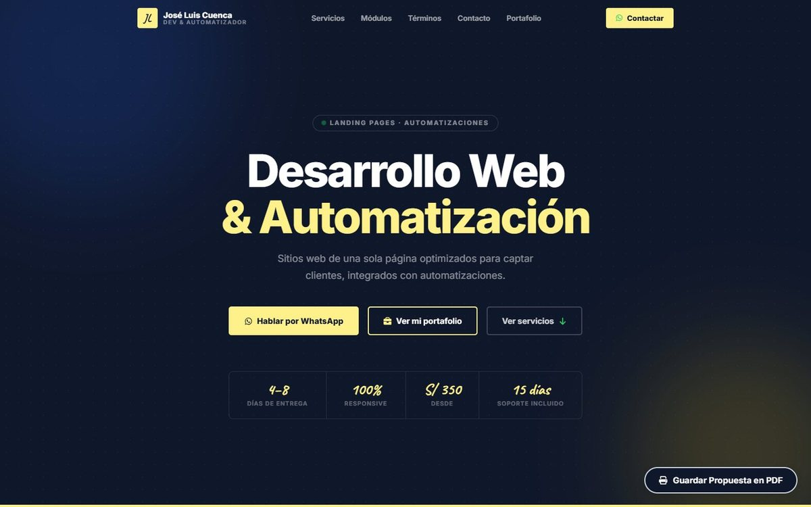
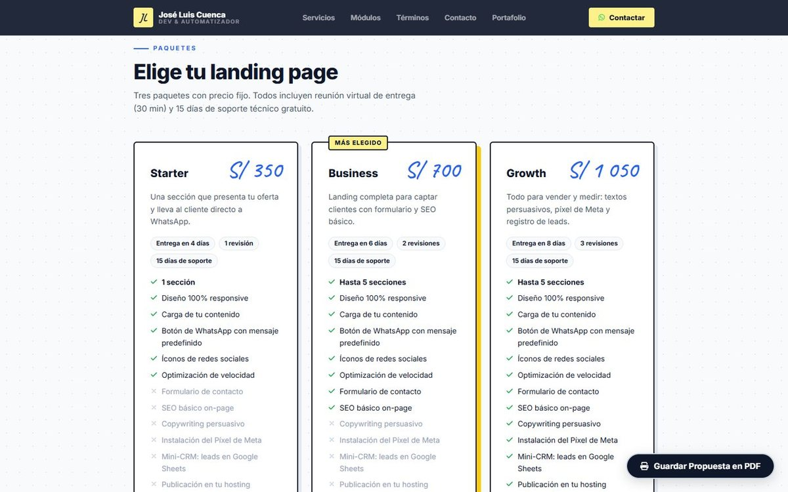
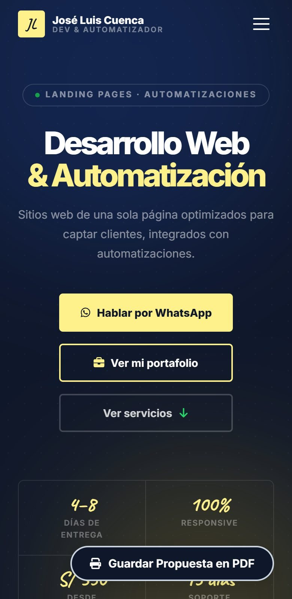

# Landing de servicios freelance

La página con la que ofrezco landing pages y automatizaciones para negocios: [portafoliofreelance-jlcg.vercel.app](https://portafoliofreelance-jlcg.vercel.app/)

Muestra tres paquetes con precio fijo (Starter, Business y Growth, desde S/ 350), los módulos opcionales y los términos de trabajo. Cada botón abre WhatsApp con un mensaje según el paquete elegido, y la página tiene estilos de impresión para guardarla como propuesta en PDF desde el navegador.

## Cómo está hecha

HTML y CSS en un solo archivo cada uno, con un poco de JavaScript para el menú y las animaciones al hacer scroll. Las fuentes (Inter y Caveat) se sirven desde el propio sitio. Tiene metadatos para buscadores y redes, sitemap, `robots.txt` y manifest, y se despliega en Vercel sin paso de build.

© 2026 José Luis Cuenca Gutiérrez. Todos los derechos reservados.
