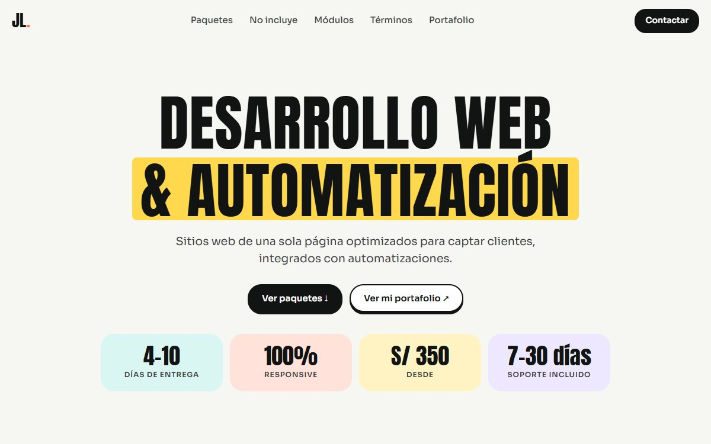
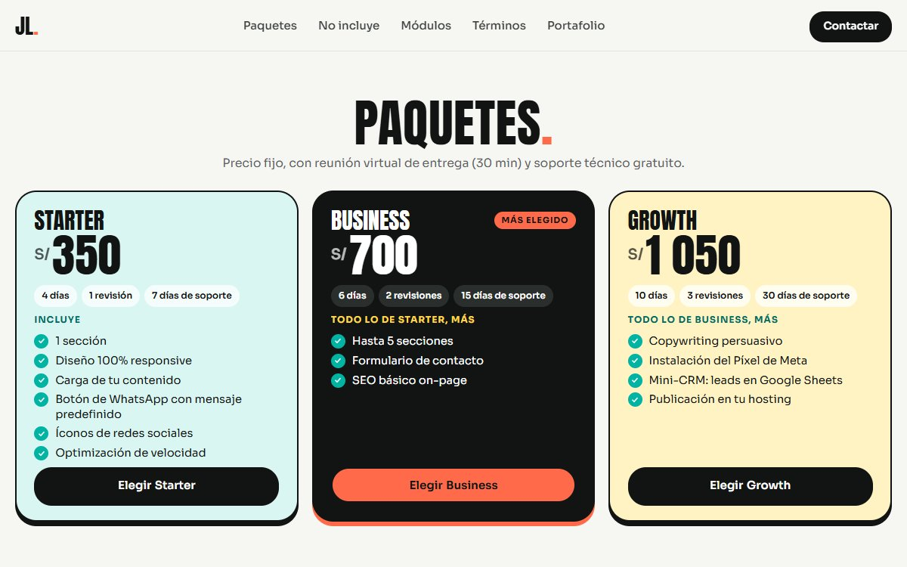
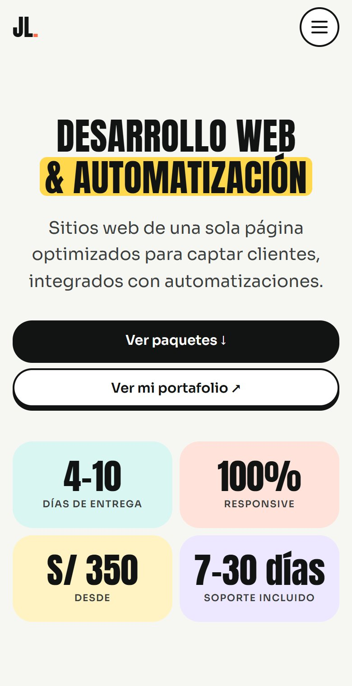

# Landing de servicios freelance

La página con la que ofrezco landing pages y automatizaciones para negocios: [portafoliofreelance-jlcg.vercel.app](https://portafoliofreelance-jlcg.vercel.app/)

Muestra los tres paquetes con precio fijo (Starter, Business y Growth, desde S/ 350), cada uno con lo que agrega al anterior, y además lo que no incluyen, los módulos opcionales y los términos de trabajo. Cada sección cabe en la pantalla, del celular al monitor. El contacto es por correo: cada botón "Elegir" abre un correo con el paquete elegido, y la página tiene estilos de impresión para guardarla como propuesta en PDF desde el navegador.

## Cómo está hecha

Un solo archivo HTML con su CSS y un poco de JavaScript para los paquetes, el menú y las animaciones al hacer scroll. Comparte el diseño de mi [portafolio](https://portafolio-jlcg.vercel.app/): títulos en Anton, texto en Sora y la misma paleta. Las fuentes se sirven desde el propio sitio. Tiene metadatos para buscadores y redes, sitemap, `robots.txt` y manifest, y se despliega en Vercel sin paso de build.

© 2026 José Luis Cuenca Gutiérrez. Todos los derechos reservados.
